# Пепельный Легион: Душа Павшего

Десктопная версия игры «Пепельный Легион» на Electron + TypeScript + Canvas 2D.

Теперь главный герой — **призрак павшего злодея**. Он поднимает души убитых врагов, собирает легион и идёт мстить Герою, который предал его. Вся графика рисуется векторно в реальном времени: у героя, врагов, боссов и предметов есть собственные анимированные спрайты.

## Скриншоты

| | |
| --- | --- |
| 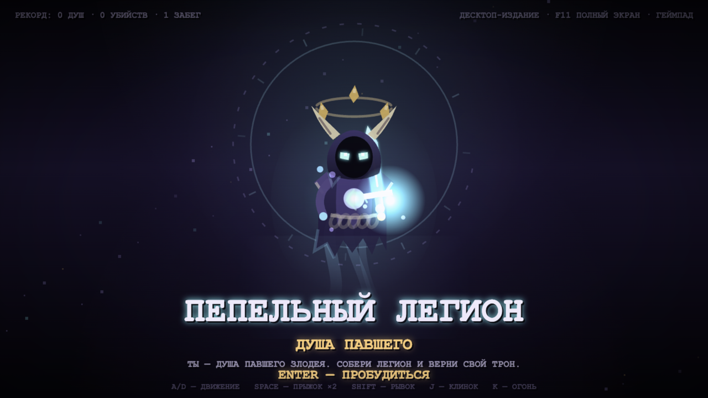 | 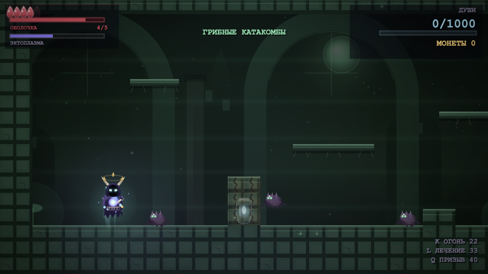 |
| 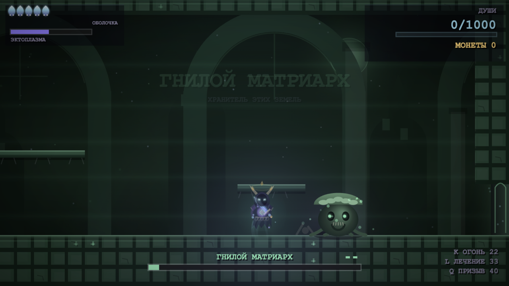 | 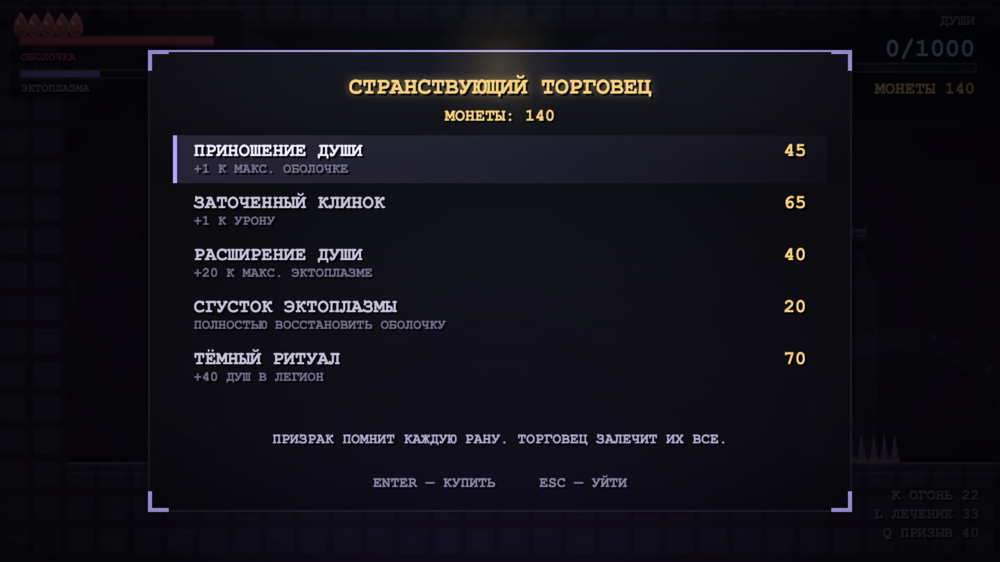 |
| 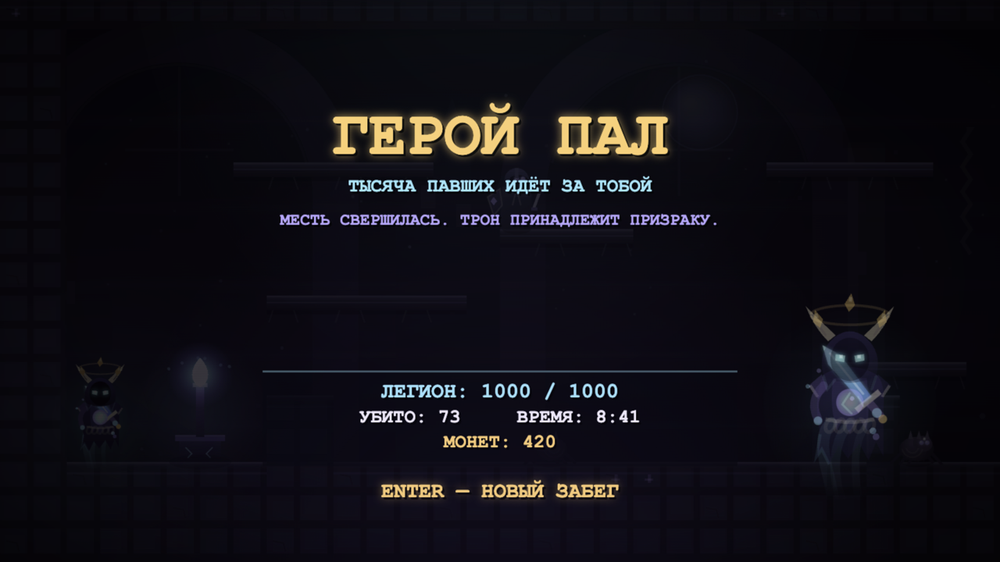 | 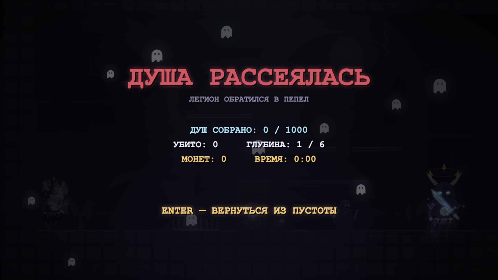 |

### Мир, тайники и торговец

| | |
| --- | --- |
| 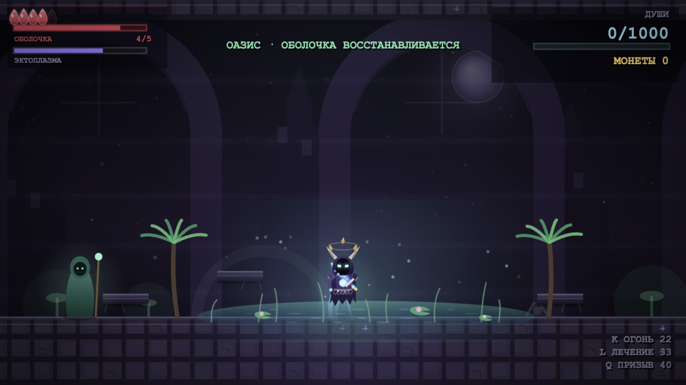 | 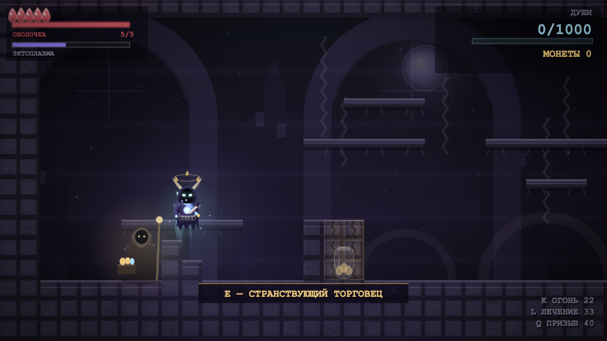 |
| 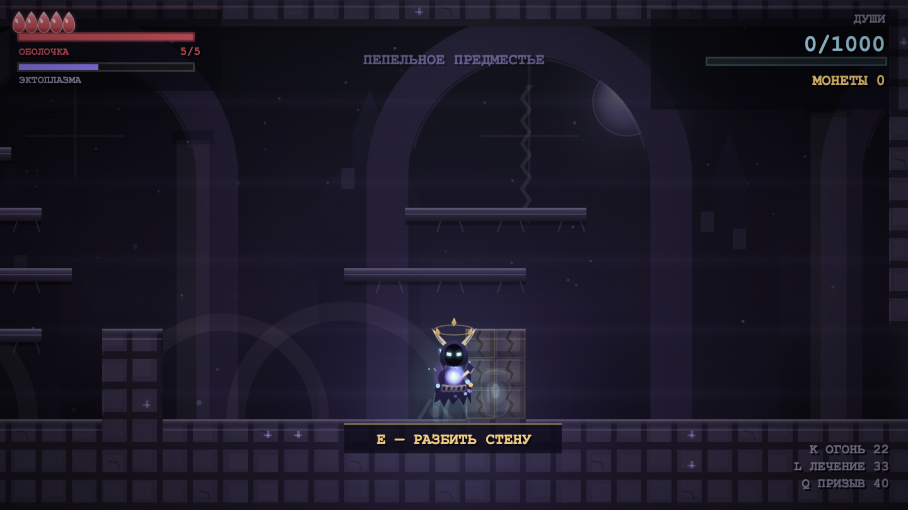 | 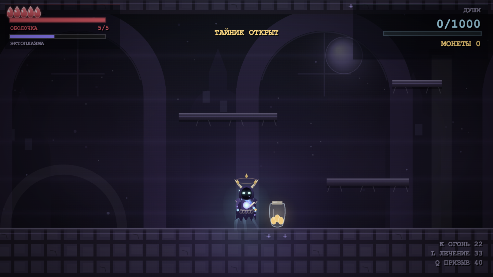 |

- **Оазис** — отдельная мирная комната без врагов. Вода, пальмы, светлячки и хранитель постепенно восстанавливают оболочку и эктоплазму.
- **Скрытые проходы** встречаются в обычных комнатах. За трещиной видна капсула с монетами или душами: нажми `E`, чтобы разбить стену, затем забери награду.
- **Странствующий торговец** появляется ровно один раз за локацию. Алтаря с бесплатным полным лечением больше нет: всё покупается за монеты.

### Инкуб-демон

Если выбрать «Съесть» кролика, в конце этой же локации вместо сюжетного босса появится огромный светловолосый инкуб-демон. У него две фазы и отдельная полоса здоровья.

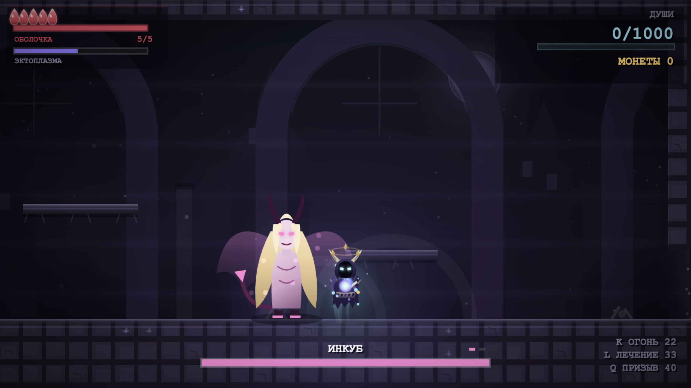


### Белый кролик и выбор

Редкий белый кролик встречается не больше одного раза на локацию. С ним нельзя драться: при подходе открывается диалог с выбором.

| | |
| --- | --- |
| 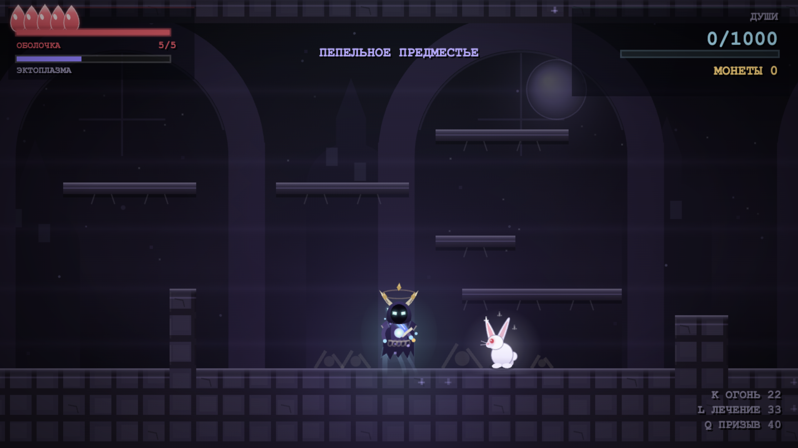 | 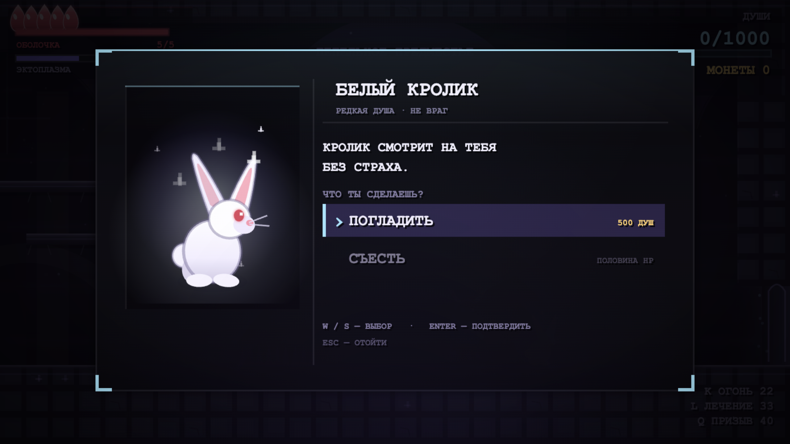 |
| 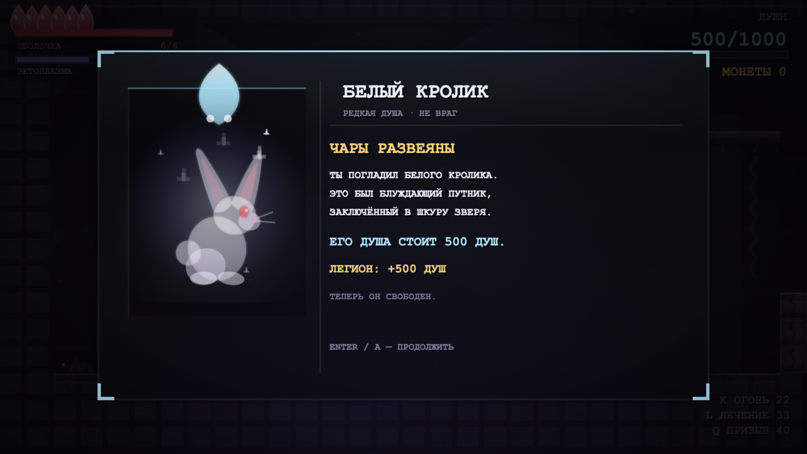 | 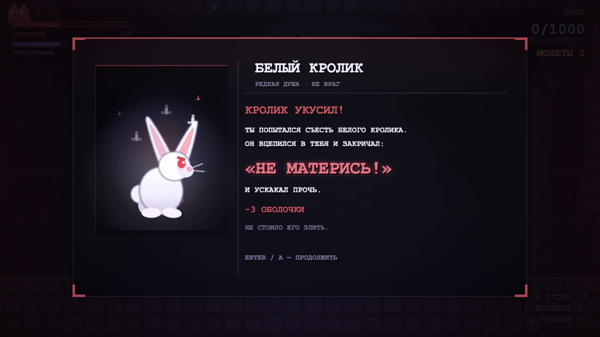 |

- **Погладить** — чары развеиваются, блуждающий путник освобождён, а его душа даёт до **500 душ**.
- **Съесть** — кролик снимает половину здоровья, кричит «НЕ МАТЕРИСЬ!» и убегает. Позже он может вернуться в облике инкуба-демона.

### Обучение

Первый забег начинается в тренировочном зале. В нём по шагам объясняются движение, двойной прыжок, рывок, удар, огонь, лечение, поднятие души, обыск, призыв легиона и меню героя.

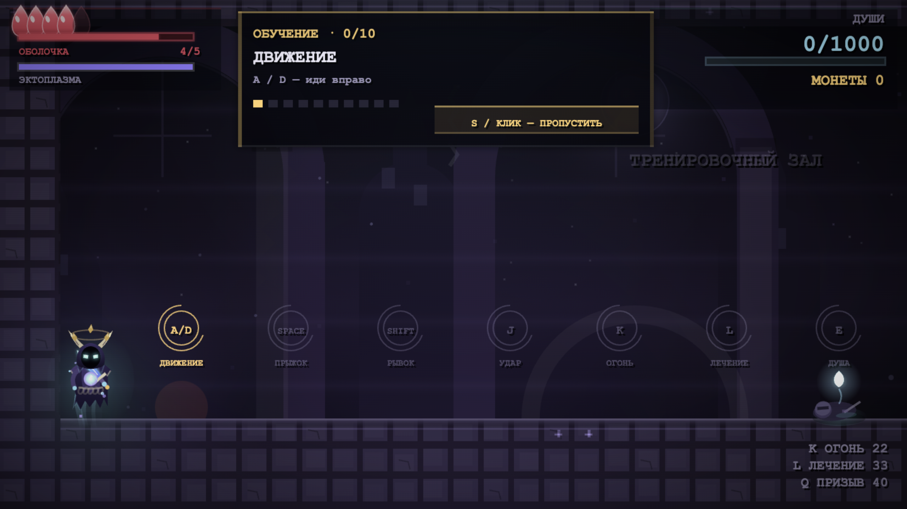

Обучение можно пропустить в любой момент: клавишей `S` или кликом по кнопке **«S / КЛИК — ПРОПУСТИТЬ»** в верхней панели. После завершения или пропуска обучение больше не показывается.

### Смерть

После гибели душа призрака распадается на маленькие полупрозрачные белые призрачки. Они поднимаются по краям экрана смерти и не мешают читать итоги забега.


## Свои SVG-спрайты

Игру можно перерисовать без изменения кода. Положи SVG в `assets/custom/` с фиксированным именем — игра подхватит его при сборке. Если файла нет, останется процедурная графика.

Поддерживаются фон (3 слоя), игрок, враги, боссы, кролик, союзники, торговец, хранитель оазиса, тайлы и портрет героя. Настройки масштаба, смещения и привязки задаются в `assets/custom/manifest.json`.

Подробности и полный список имён: [`assets/custom/README.md`](assets/custom/README.md).


## Запуск

```sh
cd desktop
npm install
npm run dev
```

`npm run dev` сам поднимает Vite и открывает Electron-окно.

Если нужен только браузерный режим для отладки:

```sh
npm run dev:web
```

## Сборка и запуск готовой версии

```sh
npm run build
npm start
```

## Сборка установщика

```sh
npm run dist
```

Готовый установщик появится в `release/`. Для быстрой проверки без установщика:

```sh
npm run package
```

На macOS приложение собирается как `Ashen Legion.app`, а в системе отображается как «Пепельный Легион». Это сделано намеренно: Electron на свежих версиях macOS падает, если в имени bundle или helper-процессов есть кириллица.

## Управление

| Клавиша | Действие |
| --- | --- |
| `A` / `D` | движение |
| `Space` | прыжок, второй прыжок в воздухе |
| `Shift` | рывок сквозь опасность |
| `J` | удар призрачным клинком |
| `K` | адский огонь |
| `L` | восстановление оболочки |
| `Q` | призыв легиона |
| `R` | атака полного легиона (1000 душ) |
| `E` | поднять душу / разбить тайник / торговец / хранитель |
| `F` | обыскать павшего |
| `Tab` / `I` | меню героя: характеристики, инвентарь и легион |
| `Esc` | пауза |
| `M` | звук |
| `F11` / `V` | полноэкранный режим |

Поддерживается геймпад: левый стик / D-pad — движение, `A` — прыжок, `X` — удар, `B` — рывок, `Y` — огонь, `LB` — лечение, `RB` — призыв, `Back` — меню героя, `Start` — пауза.

## Структура

- `main.js` — Electron-процесс, окно, фуллскрин, безопасность.
- `preload.js` — мост между Electron и игрой.
- `scripts/dev.mjs` — одновременный запуск Vite и Electron.
- `src/` — исходники игры.
- `src/art/sprites.ts` — векторный спрайт призрака-героя и иконки.
- `src/art/` — фон, эффекты, палитра.
- `src/entities/` — игрок, враги, боссы, союзники, предметы.
- `src/world/room.ts` — генерация комнат и тайлов, оазис, торговец, скрытые проходы.
- `assets/custom/` — свои SVG вместо процедурной графики, см. `assets/custom/README.md`.
- `screenshots/` — скриншоты игры.
- `REQUESTS.md` — список запросов, статусы и описание реализации.
